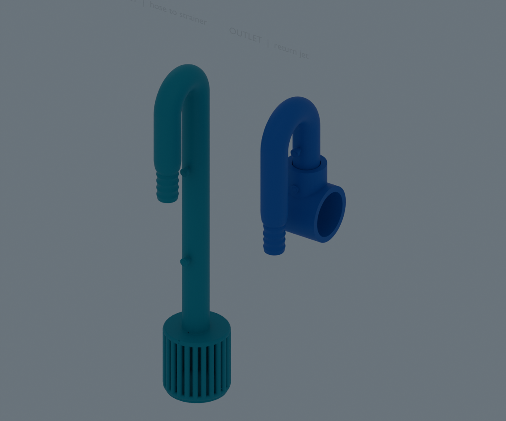
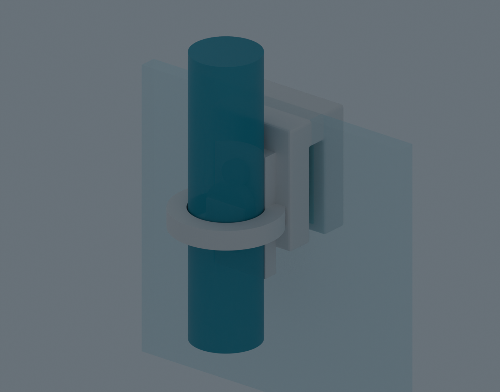

# Aquarium Canister-Filter Inlet, Outlet & Rim Mount

Original aquarium hardware designed and modeled by **Roebin Uys** in Blender. The project contains over-rim canister-filter pipes and a separate screw-clamp/ring holder for the aquarium edge.

## Printable files

- [Download the STL bundle](Aquarium_Canister_Filter_STL_Files.zip) — inlet, outlet, glass-edge clamp, pipe-ring carrier, and optional soft-contact pads.
- [Editable inlet/outlet Blender model](canister_filter_inlet_outlet.blend)
- [Editable rim-mount Blender model](aquarium_pipe_ring_rim_mount.blend)
- [View the rim-mount assembly](aquarium_rim_ring_mount_preview.png)
- [Inlet/outlet fit and print notes](canister_fittings_README.txt)
- [Rim-mount fit and assembly notes](aquarium_rim_ring_mount_README.txt)

## Design

The inlet and outlet pass over the tank rim, then bend down inside the aquarium. Their hose connections point down outside the glass. Each inner leg has two pegs intended for existing suction-cup clips. The inlet's intake cage is joined to its stem.

The outlet ends in a straight, open-ended T-shaped tunnel: the vertical return feeds the horizontal cylinder through one central swivel. Both mouths remain open. The tunnel has no sidewall holes; the swivel is the only opening along its side. Only the tube-to-tunnel joint is designed to rotate in place.

The separate rim mount follows the clamp-and-ring arrangement used by commercial pipe holders. Its C-shaped clamp fits nominal 4 mm glass, while a separate closed carrier ring holds the 16 mm outside tube leg. The mount uses M3 and M4 fasteners; optional TPU pads cushion contact with the glass.

## Fit assumptions

- Hose: estimated 12 mm inside diameter, commonly paired with 16 mm outside diameter tubing. Measure your hose before printing.
- Aquarium glass: interpreted as 4 mm; the clamp slot is 4.8 mm.
- Pipe ring: 16.6 mm bore for a nominal 16 mm outside-diameter pipe.
- The suction-cup peg dimensions and swivel clearance are estimates for a typical FDM printer, not universal standards.

## Printing and use

The fittings and holder are prototypes. Fit, flow, strength, swivel operation, watertightness, and long-term immersion have not been validated. The print-in-place swivel is not sealed and may leak. FDM parts can also seep through layer lines, and the clamp can damage glass if overtightened.

Print a small fit check, inspect and clear the water passages, then test the parts in a container under supervision. Do not rely on these parts for an unattended canister-filter installation unless they have first passed sustained leak and fit checks in your own setup. Tighten the rim clamp gently and use soft pads; never press a hard screw directly against bare aquarium glass. The optional contact pads are intended for TPU or replacement silicone.

## Research references

- [EHEIM Classic 2213 manual](https://eheim.com/media/a3/4a/c9/1770122536/2213_classic.pdf) — examples of conventional canister intake, return pipes, hose sizes and suction-cup clips.
- [ADA Lily Pipe Spin](https://www.adana.co.jp/en/contents/products/na_filter/detail04.html/1000) — context for return-flow shaping; this design uses a straight T tunnel instead.
- [AQUARIO NEO Holder installation sheet](https://aquarioiberia.com/wp-content/uploads/2023/06/FICHA-TECNICA-AQUARIO-NEO-HOLDER.pdf) — a glass-edge clamp with a separate pipe-retaining assembly.

All designs in this repository are original work by Roebin Uys. No reuse license is provided.
